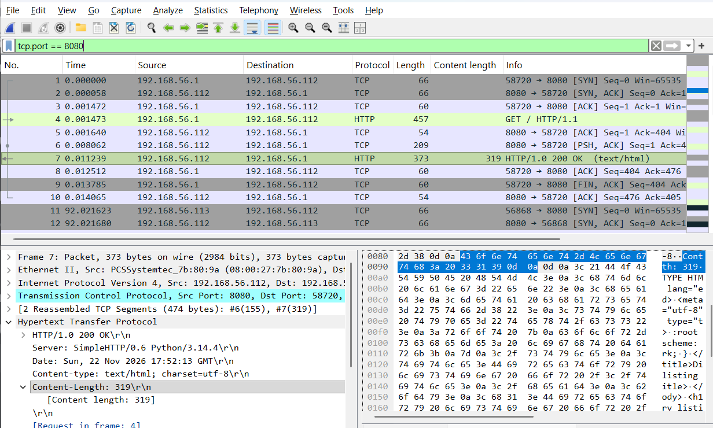

# Investigation 01 — Normal HTTP Traffic Baseline

## Objective
Establish a baseline of normal HTTP communication between client systems and the Ubuntu HTTP server.

## Environment
- HTTP server: Ubuntu Server (`192.168.56.112`)
- Clients: Windows 11 VM (`192.168.56.113`) and Windows host (`192.168.56.1`)
- Server port: TCP 8080
- Capture tool: TCPDump
- Analysis tool: Wireshark

## Activity
A Python HTTP server was started on Ubuntu. Both the Windows VM and host PC generated HTTP requests to the server.

## Wireshark Observations
- TCP connections were initiated by both client systems.
- HTTP GET requests were observed.
- Three HTTP requests were observed in the investigated traffic.
- Two responses returned `200 OK`.
- One response returned `404 Not Found` for the requested `test.txt` resource.

## Analysis
The capture demonstrated normal TCP connection establishment and HTTP request-response communication.

The `200 OK` responses indicated successful resource retrieval, while the `404 Not Found` response indicated that the requested resource was unavailable.

The different source ports represented client-side ephemeral ports used for TCP communication.

## Conclusion
The exercise established a basic HTTP traffic baseline and demonstrated how to identify client connections, HTTP methods, response codes, and TCP communication in Wireshark.

## Evidence
- PCAP: `01-normal-http.pcap`
- Wireshark filters: `tcp.port == 8080`, `http.request`, `http.response`

