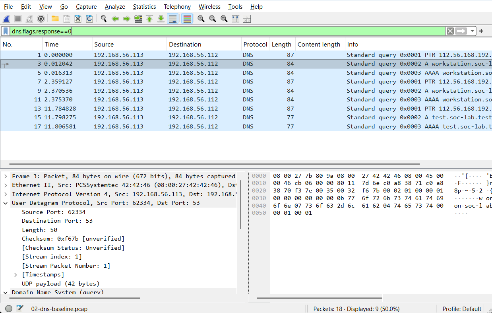

# Investigation 02 — DNS Baseline Analysis

## Objective
Understand normal DNS query and response behaviour using a controlled DNS server.

## Environment
- DNS server: Ubuntu Server (`192.168.56.112`)
- DNS service: dnsmasq
- Client: Windows 11 VM
- Protocol: DNS over UDP port 53
- Capture tool: TCPDump
- Analysis tool: Wireshark

## Activity
Configured dnsmasq to resolve names under the `soc-lab.test` lab domain to the Ubuntu server address.

The Windows VM performed a DNS lookup:

`nslookup test.soc-lab.test 192.168.56.112`

## Observations
- The lab hostname resolved to `192.168.56.112`.
- DNS query and response traffic was captured.
- A reverse DNS PTR query was also observed for `112.56.168.192.in-addr.arpa`.

## Analysis
DNS translates domain names into IP addresses.

The A record is used for IPv4 address resolution, while the AAAA record is used for IPv6 address resolution. PTR records perform reverse lookups, mapping an IP address to a hostname.

The reverse lookup name `112.56.168.192.in-addr.arpa` represents the IPv4 address `192.168.56.112`.

A DNS server appearing as `Unknown` in nslookup does not necessarily indicate a DNS failure; it can simply mean that no reverse hostname was available for the server address.

## Conclusion
The exercise demonstrated controlled DNS resolution and the structure of DNS queries, responses, and reverse DNS lookups.

## Evidence
- PCAP: `02-dns-baseline.pcap`
- DNS server: `192.168.56.112`
- Test hostname: `test.soc-lab.test`

