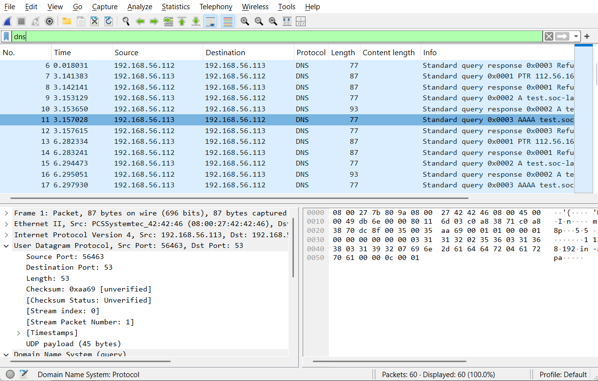

# Investigation 03 — Repeated DNS Queries

## Objective
Investigate repeated DNS requests to identify patterns that could indicate automated activity or periodic communication.

## Environment
- Client: Windows 11 VM (`192.168.56.113`)
- DNS server: Ubuntu Server (`192.168.56.112`)
- Protocol: DNS over UDP port 53
- Tools: nslookup, TCPDump, Wireshark

## Activity
Generated repeated DNS lookups for the same lab hostname using PowerShell, with approximately three-second intervals between requests.

## Observations
- 10 DNS queries were observed.
- All queries requested the same domain.
- The same DNS server was contacted.
- Queries occurred at approximately three-second intervals.

## Analysis
Repeated queries to the same domain at regular intervals can be associated with automated processes.

Possible explanations include:
- Application retries or health checks.
- Scheduled background tasks.
- Monitoring agents.
- Automated malware beaconing.

The regular timing is worth investigating, but repeated DNS requests alone do not prove malicious activity.

A SOC analyst should correlate the behaviour with the originating process, domain ownership, DNS response patterns, endpoint logs, and normal network baselines.

## Conclusion
The exercise demonstrated how repeated DNS requests and query timing can be identified in packet captures.

The observed traffic was intentionally generated in a controlled lab and is not evidence of malicious activity.

## Evidence
- PCAP: `03-suspicious-dns.pcap`
- Observed query count: 10
- Approximate interval: 3 seconds

