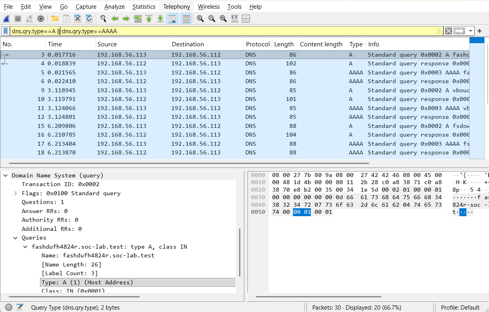

# Investigation 04 — Unusual DNS Subdomain Analysis

## Objective
Investigate unique subdomain queries and understand their relevance to possible DNS tunnelling and covert communication.

## Environment
- Client: Windows 11 VM (`192.168.56.113`)
- DNS server: Ubuntu Server (`192.168.56.112`)
- DNS service: dnsmasq
- Protocol: DNS
- Tools: nslookup, TCPDump, Wireshark

## Background
DNS tunnelling is a technique in which data may be encoded into DNS queries or responses.

An attacker controlling a domain's authoritative DNS infrastructure may use specially constructed subdomains to receive encoded information from compromised systems. DNS responses can also carry data or instructions.

Potential purposes include:
- Command-and-control communication.
- Data exfiltration.
- Delivery of commands or configuration information.
- Communication through networks where other outbound protocols are restricted.

## Activity
Generated five DNS queries using different, unusual-looking subdomains under the controlled `soc-lab.test` domain.

## Observations
- Five DNS queries were generated.
- Each query used a different subdomain.
- A and AAAA query types were observed.
- The A-record resolution returned the lab server's IPv4 address: `192.168.56.112`.

## Analysis

Unique or unusual subdomains can be relevant because attackers may encode information into DNS labels.

Indicators worth investigating include:
- Long or unusually structured subdomains.
- High-entropy or random-looking labels.
- Large numbers of unique subdomains.
- High query frequency.
- Unusual record types or response sizes.
- Repeated communication with an unfamiliar domain.

These indicators can also occur in legitimate services, including CDNs, cloud applications, and security products.

This exercise reproduced unique-subdomain behaviour only. It did not implement an actual DNS tunnel or demonstrate data exfiltration.

An AAAA query requests an IPv6 address; the IPv4 response address `192.168.56.112` corresponds to A-record resolution, not an IPv6 AAAA answer.

## Conclusion
The investigation demonstrated how unique subdomains and DNS record types can be identified and assessed.

The observed pattern is a potential investigation indicator, not proof of DNS tunnelling or malicious activity.

## Evidence
- PCAP: `04-unusual-dns.pcap`
- Unique subdomain queries: 5
- Observed query types: A and AAAA
- Lab IPv4 resolution: `192.168.56.112`

