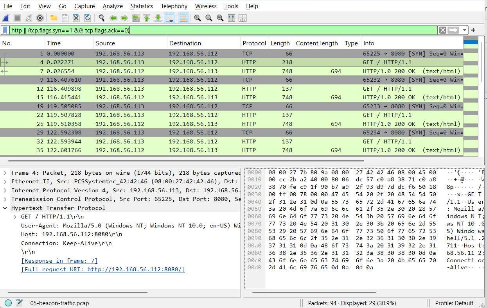

# Investigation 05 — Periodic HTTP Communication (Beaconing)

## Objective
Investigate periodic HTTP communication and identify characteristics that may resemble command-and-control beaconing.

## Environment
- Client: Windows 11 VM (`192.168.56.113`)
- Server: Ubuntu Server (`192.168.56.112`)
- Protocol: HTTP
- Destination port: TCP 8080
- Tools: curl, TCPDump, Wireshark

## Background
In a command-and-control environment, malware may periodically contact an attacker-controlled server to check for commands, report status, or exchange information.

This repeated communication is commonly described as beaconing.

HTTP and HTTPS may be used because web traffic is common in enterprise networks.

## Activity
Generated 10 HTTP requests from the Windows VM to the Ubuntu HTTP server, with approximately five-second intervals.

## Observations

| Indicator | Finding |
|---|---|
| HTTP requests | 10 |
| HTTP responses | 10 |
| Destination IP | Same for all requests |
| Requested URL | Same |
| Request interval | Approximately 5 seconds |
| Initial TCP SYN packets | 10 |
| HTTP response status | 200 OK |
| Response Content-Length | 694 bytes for all responses |
| First observed User-Agent | Mozilla/5.0 |

## Analysis
The regular request interval, consistent destination, repeated URI, and separate TCP connections demonstrate automated periodic communication.

The identical response status and content length indicate that the server returned consistent responses during the simulation.

These characteristics can resemble HTTP-based C2 beaconing. However, legitimate applications, monitoring tools, and scheduled scripts can also generate periodic HTTP requests.

The User-Agent value `Mozilla/5.0` is not sufficient to identify the originating application or prove that a browser generated the traffic.

Additional endpoint process information and destination reputation checks would be necessary in a real SOC investigation.

## MITRE ATT&CK Reference
- T1071.001 — Web Protocols.

This technique is relevant to the use of web protocols for application-layer command-and-control communication. The lab exercise itself is benign and does not implement C2.

## Conclusion
The investigation successfully reproduced and identified periodic HTTP communication using controlled traffic generation.

The traffic demonstrated beacon-like characteristics, but no malware or actual command-and-control activity was involved.

## Evidence
- PCAP: `05-beacon-traffic.pcap`
- 10 HTTP requests and responses
- 10 initial TCP SYN packets
- Approximately five-second communication intervals

