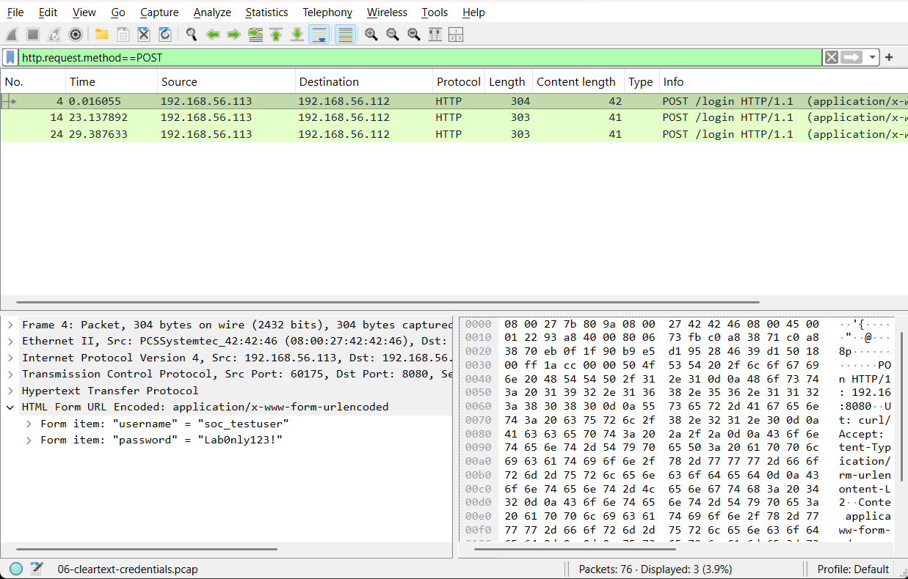
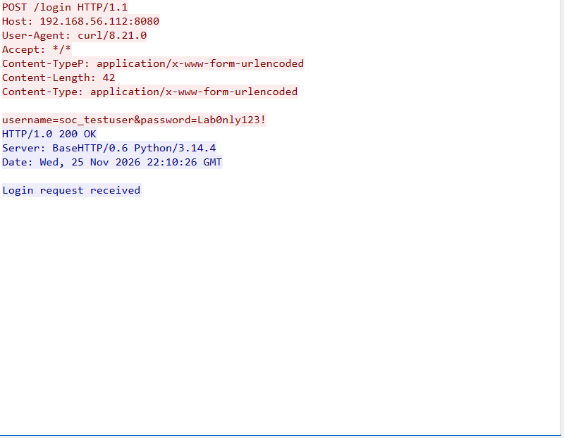

# Investigation 06 — Cleartext HTTP Credential Exposure

## Objective
Investigate whether credentials transmitted through HTTP can be recovered from a packet capture.

## Environment
- Client: Windows 11 VM (`192.168.56.113`)
- Server: Ubuntu Server (`192.168.56.112`)
- Protocol: HTTP
- Destination port: TCP 8080
- Tools: Python HTTP server, curl, TCPDump, Wireshark

## Activity
Created a controlled HTTP receiver using Python and sent a test login request from the Windows VM using curl.

Only dummy credentials were used.

## Observations
- An HTTP POST request was captured.
- The request contained form-encoded username and password fields.
- Both values were visible in the packet payload.
- The credentials could be inspected using Wireshark's HTTP stream analysis.

## Analysis
HTTP does not encrypt application-layer data in transit. Consequently, sensitive information sent through HTTP can potentially be recovered by someone capable of capturing the network traffic.

HTTPS uses TLS to encrypt application data in transit, protecting credentials from ordinary passive packet inspection when correctly configured.

## Security Impact
Cleartext credential transmission can expose user accounts to credential theft and subsequent unauthorized access.

## Conclusion
The exercise successfully demonstrated that credentials transmitted through unencrypted HTTP can be recovered from a packet capture.

The simulation used dummy credentials in an isolated lab environment. No real credentials were exposed.

## Evidence
- PCAP: `06-cleartext-credentials.pcap`
- HTTP POST request inspection
- Wireshark Follow TCP Stream analysis

