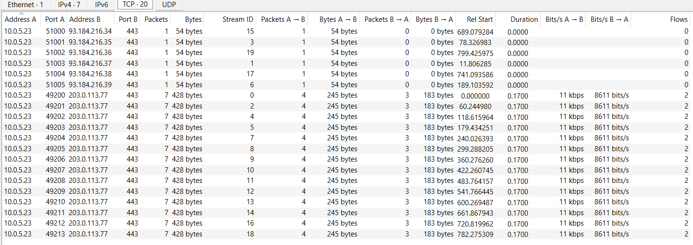

# Investigation 07 — Independent PCAP Analysis: Periodic TLS Beaconing

## 1. Investigation Overview

**Objective:** Independently investigate a network capture for suspicious periodic communication and identify indicators consistent with command-and-control (C2) beaconing.

**Dataset:** Network Forensics Lab — C2 Beaconing PCAP

**Tools:** Wireshark

**Protocol:** TCP / TLS 1.2

## 2. Network Details

| Field | Observed value |
|---|---|
| Internal endpoint | `10.0.5.23` |
| Remote destination | `203.0.113.77` |
| Destination port | `443` |
| Protocol | TCP over TLS 1.2 |
| Total connections | 14 |
| Connection interval | Approximately 60–61 seconds |

Note: `203.0.113.77` belongs to the TEST-NET-3 documentation address range. It should be treated as an anonymized or synthetic destination, not a verified real-world C2 server.

## 3. Investigation Findings

### 3.1 Connection Frequency

The internal endpoint `10.0.5.23` established 14 distinct TCP connections to `203.0.113.77:443`.

Observations:
- New TCP connections were established repeatedly.
- Connections occurred approximately every 60–61 seconds.
- Each connection followed a TCP connection establishment sequence.
- Connections terminated using FIN flags, indicating graceful TCP closure.

**Analysis:** Regular communication at nearly fixed intervals is consistent with automated beaconing behaviour. Repeatedly creating new connections rather than maintaining one persistent session strengthens this observation.

### 3.2 DNS Investigation

Applied the Wireshark display filter:

`dns`

**Result:** Zero DNS packets were present in the capture.

**Analysis:** No DNS query or response associated with the destination was observed. Possible explanations include:
- The application connects directly using an IP address.
- DNS information was already cached.
- Name resolution occurred outside the capture period or through another mechanism.

The absence of DNS packets alone does not prove that the application uses a hardcoded IP address.

### 3.3 Traffic Volume Analysis

Wireshark TCP Conversations showed consistent traffic volume across all 14 connections.

| Metric | Per connection |
|---|---:|
| Total bytes | 428 |
| Endpoint to remote | 245 |
| Remote to endpoint | 183 |
| Packets from endpoint | 4 |
| Packets from remote | 3 |
| Total packets | 7 |

**Analysis:**

Every connection had the same reported byte count and packet distribution.

This suggests a highly consistent communication pattern, potentially representing a periodic check-in or automated status request.

The reported conversation byte counts should not be interpreted as pure application payload because they may include protocol headers.

### 3.4 TLS Investigation

Observed TLS 1.2 traffic, including an Encrypted Handshake Message.

Example: Frame 5

- Source: `203.0.113.77:443`
- Destination: `10.0.5.23:49200`
- TLS content type: Handshake (22)
- TLS record version: TLS 1.2
- TCP payload length: 21 bytes

Frame 6 showed the endpoint acknowledging the received TCP data without carrying additional TCP payload.

The ClientHello and server certificate details were not established from the available capture evidence. The encrypted application contents could not be inspected.

## 4. Security Indicators

| Indicator | Assessment |
|---|---|
| Regular 60–61-second intervals | Suspicious periodic behaviour |
| Repeated connections to one destination | Consistent with beaconing |
| Identical traffic volume | Consistent automated communication |
| No DNS packets | Worth investigating, not proof of hardcoded IP |
| TLS encryption | Prevents direct inspection of application contents |
| Graceful FIN termination | Normal TCP connection closure |

## 5. MITRE ATT&CK Mapping

**Potential technique: T1071.001 — Web Protocols**

HTTPS/TLS can be used by adversaries for command-and-control communication. The observed traffic uses TLS over TCP port 443, making this technique relevant to the investigation.

This is a potential mapping based on observed protocol behaviour, not confirmation of malicious C2 activity.

## 6. Detection Logic

A network SIEM or NDR detection could identify:

- Repeated outbound TCP connections from an internal endpoint.
- Connections to the same destination IP and port.
- Approximately regular intervals between connections.
- Similar packet counts and byte volumes across consecutive connections.

**Illustrative detection condition:**

Alert when an endpoint establishes at least 5 connections to the same destination within a monitoring window, with intervals consistently around 60 seconds and similar traffic volumes.

The interval and volume thresholds should be configurable and tuned against normal network behaviour to reduce false positives.

## 7. Investigation Conclusion

The PCAP contains 14 repeated TCP connections from `10.0.5.23` to `203.0.113.77:443`, occurring approximately every 60–61 seconds.

Each connection exhibits identical reported traffic volume and packet distribution. No DNS packets were observed, and the connections terminate gracefully using TCP FIN flags.

The combined evidence is consistent with periodic automated communication and raises suspicion of C2 beaconing.

However, the PCAP alone cannot establish malicious intent, identify the responsible endpoint process, or reveal the encrypted application contents.

**Final assessment: Potential periodic C2 beaconing — further endpoint and network correlation would be required for confirmation.**

## 8. Investigation Limitations

- Encrypted TLS application data could not be inspected.
- No DNS activity was available for hostname correlation.
- The originating process could not be identified from the PCAP alone.
- The destination IP is a documentation-reserved address.
- No malware sample or endpoint telemetry was available to confirm malicious activity.

