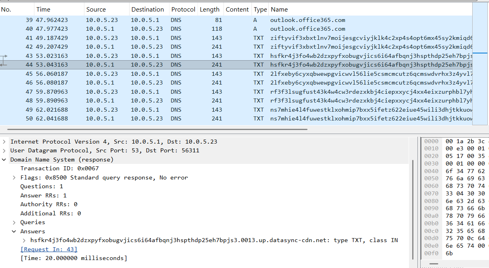

# Investigation 08 — Independent PCAP Analysis: Suspicious DNS Activity

## 1. Investigation Overview

**Objective:** Investigate suspicious DNS traffic and identify indicators potentially associated with DNS tunnelling or data exfiltration.

**Dataset:** Network Forensics Lab — DNS Tunnelling PCAP

**Tool:** Wireshark

**Protocol:** DNS

## 2. Investigation Findings

### 2.1 Most Frequently Queried Domain

The most frequently observed domain was:

`up.datasync.cdn.net`

The domain received repeated DNS queries, with TXT being the observed query type.

**Analysis:**

TXT records can carry arbitrary text data in DNS responses. Although TXT queries have legitimate uses, repeated TXT requests combined with unusual subdomain structures can indicate potential DNS tunnelling.

### 2.2 Unusual Subdomain Characteristics

The DNS queries contained:

- Long subdomain labels.
- Random-looking alphanumeric strings.
- Different labels across individual queries.

**Analysis:**

DNS tunnelling can encode information into DNS query labels. Unique and unusually long labels may represent encoded data transmitted through DNS requests.

An attacker could potentially use this technique to:
- Exfiltrate information from an internal network.
- Establish DNS-based command-and-control communication.
- Transfer data through attacker-controlled DNS infrastructure.

The observed label characteristics are suspicious but do not independently prove that the queries contain encoded or stolen information.

### 2.3 DNS Query Frequency

Using Wireshark's I/O Graphs and the DNS query display filter, the traffic showed steady activity.

Observed values:

| Metric | Result |
|---|---:|
| Total TXT queries | 103 |
| Capture duration | 130 seconds |
| Average query rate | 0.79 queries/second |
| Approximate queries per minute | 47.5 |
| Traffic pattern | Steady activity |

Calculation:

`103 / 130 = 0.7923 queries/second`

**Analysis:**

The endpoint generated repeated TXT queries throughout the capture.

A continuous stream of unique DNS queries can reduce the usefulness of normal DNS caching because each unique subdomain may require a separate lookup.

However, query frequency alone cannot establish whether DNS caching was bypassed or whether data exfiltration occurred.

## 3. Security Indicators

| Indicator | Assessment |
|---|---|
| Repeated queries to one domain | Suspicious pattern |
| TXT record requests | Potential tunnelling indicator |
| Long random-looking labels | Potential encoded data |
| Unique subdomains | May reduce DNS cache effectiveness |
| Steady query activity | Consistent with automated communication |
| Approximately 47.5 queries/minute | Worth investigating in context |

## 4. MITRE ATT&CK Mapping

**T1071.004 — Application Layer Protocol: DNS**

Adversaries may use DNS to communicate with command-and-control infrastructure.

**T1048 — Exfiltration Over Alternative Protocol**

Potentially relevant if the DNS queries are carrying information out of the environment. This behaviour was not confirmed by the available PCAP evidence.

## 5. Detection Logic

A network monitoring or SIEM detection could identify:

- Unusually frequent DNS TXT queries.
- Repeated requests to the same registered domain.
- Long or high-entropy subdomain labels.
- A high number of unique subdomains.
- Consistent DNS activity over a short period.

**Illustrative detection condition:**

Alert when an internal endpoint generates a high volume of TXT queries to the same domain, with numerous unique and unusually long subdomain labels within a defined time window.

Detection thresholds should be tuned using normal DNS traffic baselines to reduce false positives.

## 6. Investigation Conclusion

The PCAP contains repeated TXT queries to `up.datasync.cdn.net`, with long, random-looking and unique subdomain labels.

A total of 103 TXT queries were observed over 130 seconds, corresponding to approximately 0.79 queries per second.

The combination of TXT requests, unique subdomain labels and steady query activity is consistent with suspicious DNS behaviour and raises the possibility of DNS tunnelling or DNS-based data exfiltration.

However, the PCAP alone does not prove that encoded data was transmitted, that information was exfiltrated, or that the domain is malicious.

**Final assessment: Potential DNS tunnelling — further investigation and correlation with endpoint and DNS server telemetry would be required for confirmation.**

## 7. Investigation Limitations

- The contents of the DNS responses were not established as exfiltrated data.
- No authoritative DNS server logs were available.
- The responsible endpoint process was not identified.
- No endpoint telemetry was available to confirm malicious activity.
- Query frequency and label characteristics are indicators, not proof of DNS tunnelling.

