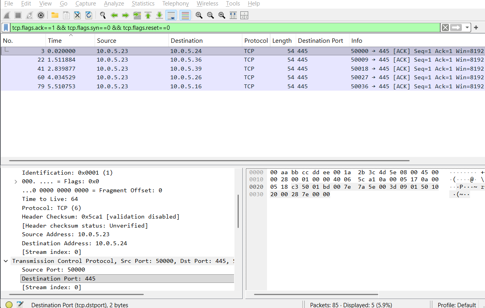

# Investigation 09 — Independent PCAP Analysis: SMB Network Sweep

## 1. Investigation Overview

**Objective:** Identify internal network reconnaissance activity involving SMB service discovery and evaluate connection responses.

**Dataset:** Network Forensics Lab — Lateral Movement SMB Sweep PCAP

**Tool:** Wireshark

**Protocol:** TCP / SMB

## 2. Network Details

| Field | Observed value |
|---|---|
| Source endpoint | `10.0.5.23` |
| Destination service | SMB |
| Destination port | TCP/445 |
| Unique destination IPs | 40 |
| Total scan duration | 5.9 seconds |

## 3. Investigation Findings

### 3.1 Internal Destination Discovery

The source endpoint `10.0.5.23` attempted TCP connections to 40 distinct internal destination IP addresses on port 445.

**Analysis:**

Port 445 is commonly used for SMB communication in Windows environments.

Attempting to contact 40 different internal hosts on the same service within a short period is consistent with automated network service discovery.

### 3.2 Connection Response Analysis

The 40 destination hosts produced the following responses:

| Response | Count | Percentage |
|---|---:|---:|
| SYN-ACK | 5 | 12.5% |
| RST-ACK | 35 | 87.5% |
| Total | 40 | 100% |

**Analysis:**

- SYN-ACK responses indicate that the destination accepted the initial TCP connection request and was willing to establish a connection.
- RST-ACK responses indicate that the destination actively rejected the connection, commonly because the port was closed or not accepting connections.

The high proportion of RST-ACK responses suggests that the source was probing multiple internal hosts to identify systems with accessible SMB services.

### 3.3 TCP Handshake Verification

Further inspection confirmed that all five destinations responding with SYN-ACK completed the TCP three-way handshake with `10.0.5.23`.

The handshake sequence was:

1. SYN — Source initiates connection.
2. SYN-ACK — Destination responds.
3. ACK — Source completes the handshake.

**Analysis:**

The five destinations successfully established TCP connectivity with the source endpoint.

However, a completed TCP handshake does not establish that SMB authentication succeeded or that files, shares or administrative resources were accessed.

## 4. Security Indicators

| Indicator | Assessment |
|---|---|
| 40 unique internal destinations | Broad internal host discovery |
| TCP port 445 | SMB service probing |
| 5.9-second time window | Rapid automated activity |
| 35 RST-ACK responses | Most destinations rejected connections |
| 5 completed TCP handshakes | Five destinations accepted TCP connections |

## 5. MITRE ATT&CK Mapping

**T1046 — Network Service Discovery**

The source endpoint probed multiple internal hosts for an available network service, consistent with service discovery.

**T1021.002 — SMB/Windows Admin Shares**

This is a potential follow-on technique if the discovered SMB services are subsequently used for lateral movement. The current capture does not demonstrate this activity.

## 6. Detection Logic

A network monitoring or SIEM detection could identify:

- A single internal source connecting to numerous distinct internal IP addresses.
- Repeated connection attempts to TCP port 445.
- A high destination-IP count within a short time window.
- A mixture of SYN-ACK and RST-ACK responses.

**Illustrative detection condition:**

Alert when one internal endpoint attempts connections to TCP/445 on at least 20 distinct internal destination IPs within 10 seconds.

Thresholds should be adjusted to the organisation's network baseline and legitimate SMB administration activity.

## 7. Investigation Conclusion

The PCAP shows that endpoint `10.0.5.23` attempted SMB connections to 40 distinct internal destination IPs within approximately 5.9 seconds.

Of these attempts, five destinations returned SYN-ACK and completed TCP three-way handshakes, while 35 returned RST-ACK.

The rapid probing of multiple internal hosts over SMB is consistent with automated network reconnaissance and service discovery.

**Final assessment: Suspicious SMB network sweep — consistent with MITRE ATT&CK T1046 (Network Service Discovery).**

The capture does not establish successful SMB authentication, file access, exploitation or lateral movement.

## 8. Investigation Limitations

- SMB authentication was not confirmed.
- No evidence of successful file or administrative share access was established.
- No endpoint process telemetry was available to identify the scanning process.
- The capture establishes network reconnaissance behaviour but does not independently prove malicious intent.

